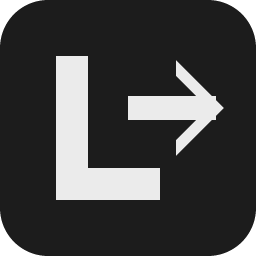

# LShift



[English](README.md) · **Русский**

Дважды нажмите левый Shift, чтобы исправить слово или выделение, набранное в неправильной раскладке. LShift преобразует текст между English US QWERTY и Русской ЙЦУКЕН.

**Windows 10/11 x64 · Готовый EXE**

[Скачать LShift.exe](https://github.com/VoyagerVPN/LShift/releases/latest/download/LShift.exe) · [Обсуждения](https://github.com/VoyagerVPN/LShift/discussions)

## Быстрый старт

1. Добавьте в Windows раскладки **English (US)** и **Русская**, затем запустите `LShift.exe`.
2. Наберите `ghbdtn` и дважды нажмите **левый Shift**. Получится `привет`. Команда работает с выделенным текстом или с последним словом перед курсором.
3. Дважды щёлкните по значку в трее, чтобы изменить язык интерфейса, настроить интервал нажатий или включить автозапуск.

Если подходящего текста нет, команда переключит раскладку. Слова, в которых уже смешаны кириллица и латиница, сохраняются. [Особенности работы и диагностика](docs/usage-notes.ru.md).

## Сборка из исходников

Понадобятся Node.js 24 и Visual Studio 2022 или 2026 с компонентами C++ Desktop, Windows SDK, CMake и Ninja.

```powershell
node scripts/build.mjs
```

EXE появится в `dist/`. См. [проверки](docs/VALIDATION.md) и [список изменений](CHANGELOG.md).

## Лицензия

[MIT с Commons Clause 1.0](LICENSE). Данные для атрибуции есть в [NOTICE](NOTICE), ограничения на продажу описаны в [LICENSE](LICENSE).
